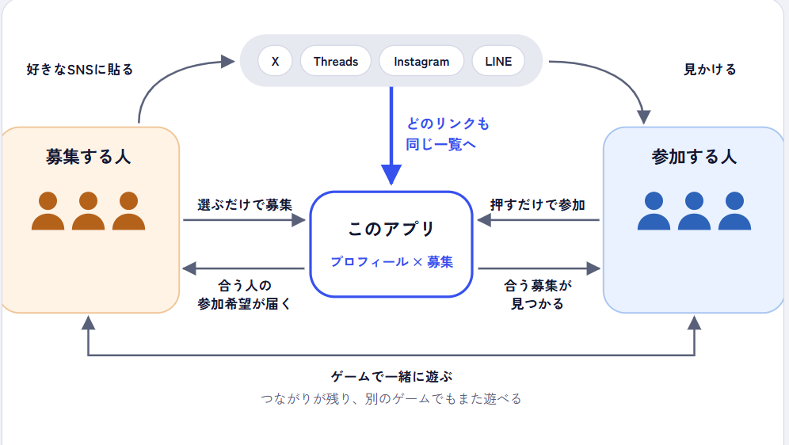

# 趣味トモ

- **本番環境**：https://tkb2616.expo.app
- **モック版**（ログイン不要で全画面を体験できます）：https://ichi-choken.github.io/tkb_2616/
- **紹介動画**：下の動画

https://github.com/user-attachments/assets/caa63c27-0d29-4076-8d9e-dcddb73fb0aa


ローカルで動かす場合（Node.js 24.3 以上）：

```sh
npm run setup
npm run start:local
```

## 【製品概要】

**SNSに散らばる募集と、機種ごとに散らばる「好き」を、ひとつに。**

趣味トモは、ゲームを中心とした趣味仲間の募集アプリです。募集もプロフィールもリンクとして SNS に貼れるので、相手がアプリを入れていなくても、今日から使えます。

### 背景（製品開発のきっかけ、課題等）

誰かと遊びたいゲームがあっても、そのために必要な情報は、各SNSやプラットフォームで分断されています。私たちはこの点に着目しました。

1. ゲームの募集はSNSごとに散らばり、DMでのやり取りも煩わしい。熱量が合わない相手と組むこともある
2. 自分がハマっているものを「表現する場」がない
3. 一度遊んでも、次につながらない

### 製品説明（具体的な製品の説明）

これらの課題に対して、趣味トモは3つの機能で解決します。SNSの境界をまたいで募集を見つけやすくする「募集」、好きなものをまとめられる「プロフィール」、つながりを残す「フレンド」です。DMはなく、参加希望と承認だけで合流まで進みます。

1. **募集**：ゲームと条件（日時・人数・熱量・VCなど）を選ぶと、リンク付きの招待状ができます。X・Threads・LINEには数タップで投稿でき、コピーすればDiscordなどにも貼れます。どこに貼られたリンクを開いても、その募集を先頭に同じゲームの募集が並びます。閲覧はログイン不要で、参加は Discord / Google / Steam でログインして申し込みます。募集者が承認すると、部屋番号や招待URLが成立した相手にだけ表示されます。
2. **プロフィール**：遊んでいるゲーム（機種・熱量・実力）と、ゲーム以外の趣味や好きなものを、1つにまとめて見せられます。
3. **フレンド**：一緒に遊んだ相手とも、同じゲームを遊ぶ人とも、フレンドになれます。遊んだあとにお互いがつながりを残せるほか、ゲームや遊び方を選んで出す「フレンド募集」から、まだ遊んだことのない人ともつながれます。フレンドの一覧から、そのゲームの募集をすぐに出せます。

### 特長

#### 1. 普及していなくても、今日から価値が出る

既存のゲーム募集アプリは、相手も同じアプリを使っていなければ、仲間が見つかりません。使う人が少ないうちは募集が集まらず、募集が無いから使う人も増えない、という壁があります。趣味トモは、この壁を越えるために、入口を今ある SNS に置きました。

- **募集はリンクで**：募集リンクを、いつもの SNS に貼るだけです。見る人は、インストールもログインも要りません。
- **プロフィールもリンクで**：プロフィールはリンクとして、SNS のプロフィール欄など、どこにでも載せられます。リンクを貼れない場所には、アプリIDを書いておけます。
- **使われるほど広がる**：貼られたリンクそのものがアプリの宣伝になり、使う人が増えるほど入口も増えていきます。

#### 2. どこに貼った募集リンクからも、アプリに集まる

X や Discord に貼られた募集は、ふつうはその場所を見ている人にしか届きません。趣味トモでは、アプリで作った募集リンクを複数の SNS に数タップで投稿でき、どのリンクから入っても、そのゲームの募集はアプリの中で1つの一覧に集まります。アプリが SNS どうしを仲介することで、関わる人それぞれにメリットが生まれます。

- **募集する人**：自分のリンク以外（ほかの人の募集リンク）からも人が来ます。参加希望から合流までアプリの中で完結するので、複数の SNS に出した募集の管理も楽です。
- **参加する人**：アプリを通すので、ある程度安心できます（DM なし・承認制）。同じゲームのほかの募集とも比べられ、今の募集以外でフレンドを作ったり、別のゲームの募集を見たりもできます。



#### 3. ゲームや機種をまたいで、「いまの遊び方」が伝わる

ゲームのプロフィールは機種やタイトルごとに分かれていて、熱量や遊べる時間はどこにも載っていません。趣味トモは、複数の機種のゲームと、ゲーム以外の趣味や好きなものを1つにまとめ、熱量（ゆるい〜ガチ）・実力・遊べる時間を選択式でそろえます。自由記述ではないので相手と比べられ、ハマっているものを気負わず並べられます。Steam のゲームとプレイ時間は自動で取り込みます。

ゲームの情報には IGDB を使っています。PC だけでなく、Switch・PlayStation・スマホのゲームまでほぼすべてを1つの土台で扱えるので、機種の境界をまたいで、同じ形でまとめられます。

- **表記がそろう**：「Apex」と「エーペックス」のように書き方が違っても、同じゲームとして扱います。日本語の題名や別名からも探せます。募集の一覧も、このそろったゲームの単位でまとまります。
- **情報と画像が自動で入る**：ゲームを選ぶだけで、正式な名前・対応機種・カバー画像が入ります。手で書く必要はありません。

#### 4. 遊んで終わりにせず、仲間とつながり続けられる

今の募集は、一緒に遊んだら関係が終わりがちです。趣味トモでは、遊んだ相手や、フレンド募集で知り合った人とフレンドになれ、フレンドの一覧からすぐに次の募集を出せます。遊ぶゲームが変わっても、仲間との関係が続きます。

### 解決出来ること

| 背景の課題 | 趣味トモで変わること |
| --- | --- |
| 1. 募集が散らばり、DMのやり取りが煩わしく、熱量が合わないこともある | どのリンクからでも同じゲームの募集をまとめて比べられ、熱量・時間・VCは選択式で事前に分かる。参加希望と承認だけで合流でき、DMは要らない |
| 2. ハマっているものを表現する場がない | 機種やジャンルをまたいで、ハマっているものを1つのプロフィールに並べられる |
| 3. 一度遊んでも、次につながらない | 遊んだ相手やフレンド募集で知り合った人とフレンドになり、次の遊びに誘える |

### 今後の展望

- 合う理由の表示（「同じくゆるめ」「遊ぶ時間が近い」など）
- フレンドが新しい募集を出したときの通知
- 条件変更時の参加の再確認
- アプリ版のプッシュ通知（配信の仕組みは実装済み）
- YouTubeの同時視聴など、ゲーム以外の募集への拡張

なお、今は Supabase・EAS Hosting・IGDB・Steam Web API の無料の範囲だけで動いていて、維持費はほとんどかかりません。

### 注力したこと（こだわり等）

- **DMを作らない**：知らない人との個別のやり取りをなくし、出会い目的の使われ方を防ぎます。やり取りは、選択式の条件・参加希望・承認だけで完結させました。
- **相手に見せる情報を最小限に**：部屋番号・招待URL・ゲーム内IDは、承認して成立した相手にだけ見せ、遊び終わると双方から消えます。招待状には載りません。
- **入口のハードルを下げる**：募集一覧は、インストールもログインもせずに見られます。ログインが要るのは、参加するときだけです。
- **信頼の目安は、偽りにくい事実だけ**：自己申告ではなく、Steam のアカウント年数やプレイ時間など、APIから取れる事実だけを出します。取れなかった値を0時間として見せることもしません。

### 実装の状況

| 機能 | 状況 |
| --- | --- |
| 募集作成（招待状・コピー・X共有）、募集一覧、参加希望、承認、成立・合流情報 | 本番環境で稼働 |
| Discord / Google / Steam ログイン、Steamライブラリの取り込み、信頼の目安、カバー画像、ゲーム検索 | 本番環境で稼働 |
| プロフィール | 本番環境で稼働（端末に保存） |
| フレンド募集・申請・承認・フレンド一覧 | 本番環境で稼働 |
| 遊んだ相手・プロフィールからのフレンド申請、フレンドの通知、共通点の表示、合う理由 | モック版のみ |
| プロフィールのリンク共有、アプリIDで探す | モック版のみ |
| 条件変更の再確認、プッシュ通知 | 未実装 |

## 【開発技術】


### 活用した技術

#### API・データ
* Supabase（PostgreSQL・Auth・Edge Functions・Realtime・pg_cron / pg_net）
* Steam Web API（所持ゲーム・プレイ時間・レベル）、Steam OpenID（ログイン・連携）
* Discord OAuth2 / Google ログイン（Supabase Auth）
* Google（ログイン認証用）
* IGDB API（Twitch OAuth）：ゲーム検索・カバー画像
* Expo Push API（配信の仕組みのみ実装、未稼働）

#### フレームワーク・ライブラリ・モジュール
* TypeScript
* Expo SDK 58 / React Native 0.88 / React 19 / react-native-web
* Expo Router、expo-auth-session、expo-notifications、expo-sqlite、AsyncStorage
* @supabase/supabase-js
* Deno（Supabase Edge Functions）
* PGlite（DBテスト）、Node.js Test Runner、GitHub Actions
* EAS Hosting（本番環境）、GitHub Pages（モック版）

#### デバイス
* PC・スマートフォンのWebブラウザ
* スマートフォン（iOS / Android、ビルドまで確認）

### 独自技術

#### ハッカソンで開発した独自機能・技術
* **募集から合流までを、PostgreSQL関数とRLSで実装**：公開・参加希望・承認・合流情報の更新・受付終了をDB関数（RPC）に集約し、承認の前後で見せる情報（部屋番号・招待URL・ゲーム内ID）をRLSで出し分けています。状態の変更は行ロックで定員の超過を防ぎ、操作IDによる冪等化で、通信が切れて再送しても二重に処理されません。
  * [supabase/migrations/20261024043000_first_flow.sql](supabase/migrations/20261024043000_first_flow.sql)（commit `17925a9`）
  * [supabase/migrations/20261024150000_approved_screens.sql](supabase/migrations/20261024150000_approved_screens.sql)（commit `77d0ba4`）
* **Steam連携による「信頼の目安」と自動更新**：SteamIDやライブラリ全体は公開せず、アカウント年数・レベル・所持の有無・プレイ時間だけを表示します。pg_cronで定期的に更新し、非公開や取得失敗は「0時間」と区別して扱います。
  * [packages/integrations/src/trust.ts](packages/integrations/src/trust.ts)、[packages/integrations/src/steam.ts](packages/integrations/src/steam.ts)、[supabase/functions/steam-trust/index.ts](supabase/functions/steam-trust/index.ts)（commit `6214404`、`0f78a61`）
* **日本語対応のゲーム検索**：IGDBを、日本語のタイトルや別名の部分一致でも検索できるようにし、選んだゲームを保存します。
  * [packages/integrations/src/igdb.ts](packages/integrations/src/igdb.ts)、[supabase/functions/igdb-search/index.ts](supabase/functions/igdb-search/index.ts)（commit `b98d27f`）
* **SteamのアプリIDからカバー画像を自動取得**：固定の対応表を使わず、IGDBの外部IDとの照合で画像を取得します。
  * [packages/integrations/src/igdb.ts](packages/integrations/src/igdb.ts)、[app/src/profile-game-covers.ts](app/src/profile-game-covers.ts)（commit `39d6368`、`6d76672`）
* **Steam OpenID 2.0を、Supabase Authのカスタムプロバイダとして統合**：Steam OpenIDをOAuth2の形に包み、Discord / Googleと合わせて3方式でログインできるようにしました（Appleは準備中）。
  * [src/auth/flow.ts](src/auth/flow.ts)、[packages/integrations/src/steam-login.ts](packages/integrations/src/steam-login.ts)、[packages/integrations/src/linking.ts](packages/integrations/src/linking.ts)（commit `4d7c101`）
* **Expoで、Web・iOS・Androidを1つのコードに**：募集・一覧・参加希望・承認・成立の画面をDBにつなぎ、本番のWebはEAS Hostingで公開しています。mainへのpushで自動デプロイされます。
  * [app/src/screens](app/src/screens)、[src/live](src/live)（commit `d391edc`、`9d7e57d`）

### 事前に準備したもの

Hack Dayの前に、仕様（受け入れ条件）と設計判断の記録を、チームの非公開リポジトリで文書として準備しました。チーム内での企画共有用にモックの画面も作成しましたが、本リポジトリのコードには使用していません。

本リポジトリのコードは、JPHACKSが用意した最初のコミットを除き、すべてHack Day開始（2026年10月24日）以降に書いたものです。
